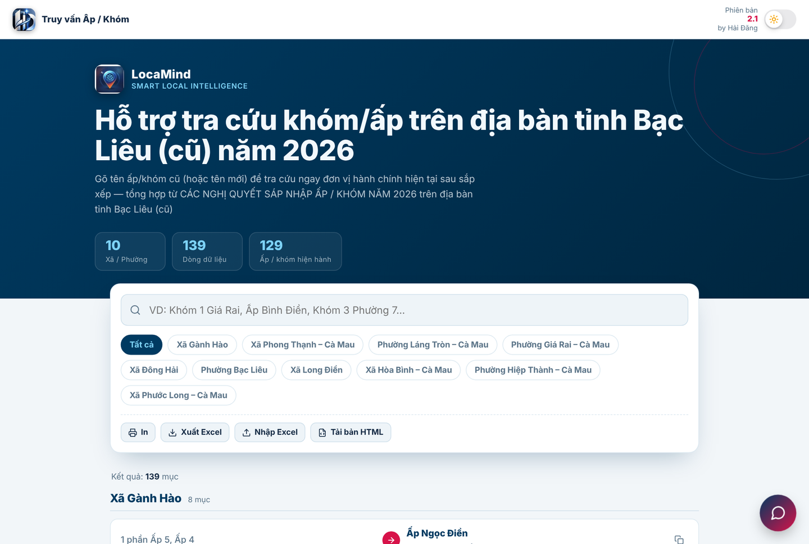
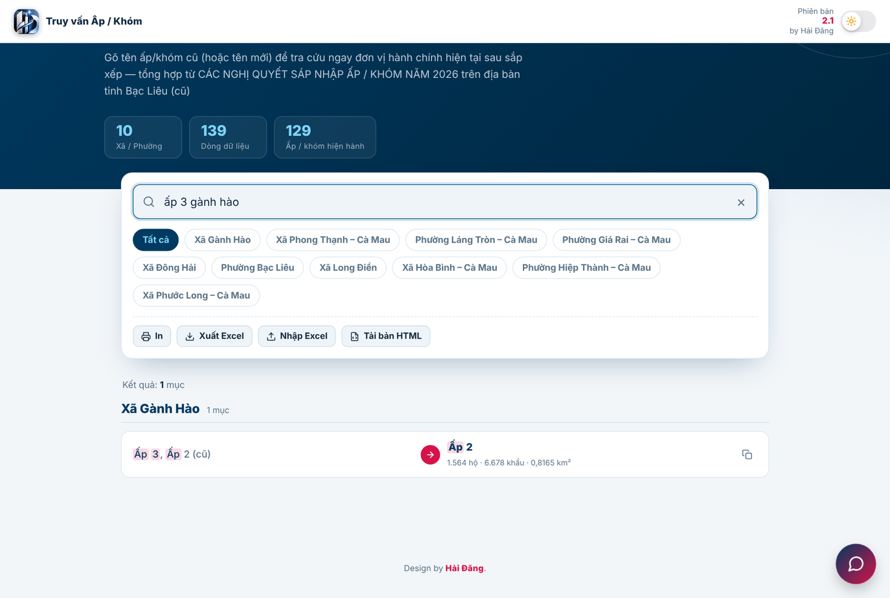
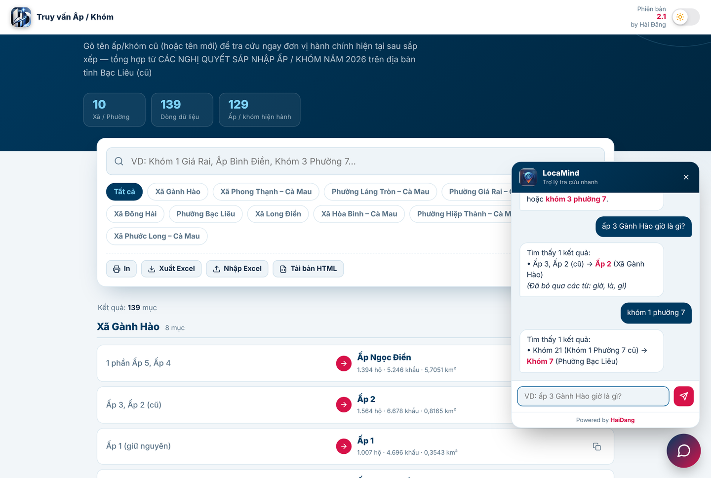
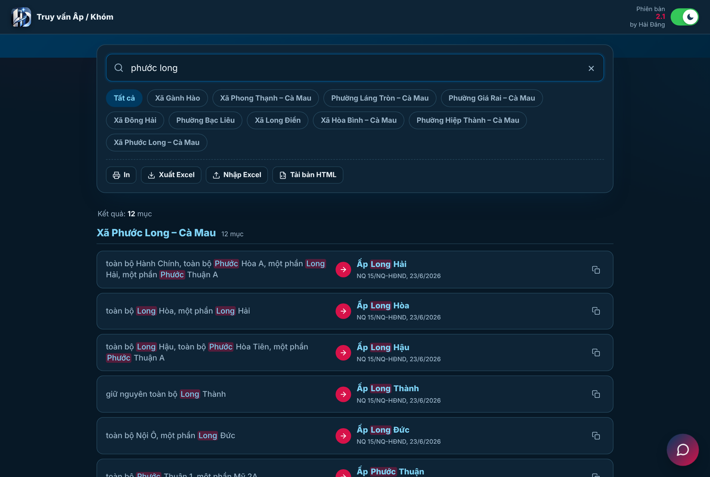
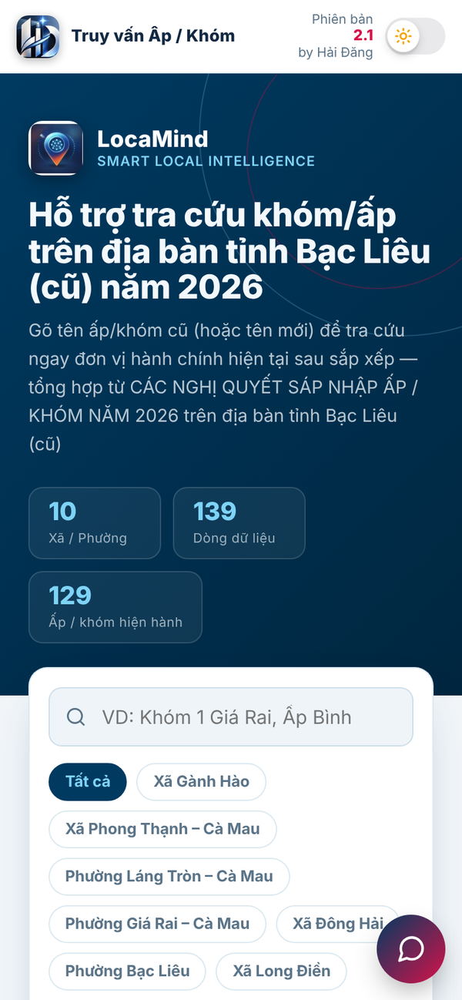
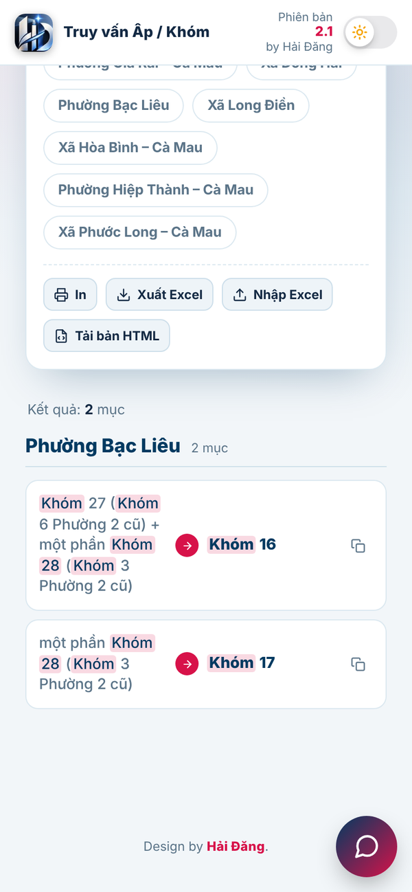

<p align="center">
  
</p>

<h1 align="center">LocaMind — Tra cứu khóm/ấp Bạc Liêu (cũ) 2026</h1>

<p align="center">
  Gõ tên ấp/khóm <b>cũ</b> (hoặc tên mới) để biết ngay đơn vị hiện hành sau đợt sắp xếp ấp, khóm năm 2026<br>
  trên địa bàn tỉnh Bạc Liêu (cũ). Chạy hoàn toàn offline, chỉ một file HTML.
</p>

<p align="center">
  <a href="https://locamind.vercel.app"><b>👉 Dùng ngay: locamind.vercel.app</b></a>
  &nbsp;·&nbsp; Phiên bản <b>2.1</b> &nbsp;·&nbsp; Design by <b>Hải Đăng</b>
</p>

<p align="center">
  
</p>

## Tính năng chính

- **Tra cứu không dấu, hai chiều**: gõ tên cũ hoặc tên mới đều ra kết quả; gõ thêm tên xã/phường để thu hẹp, ví dụ `khóm 1 giá rai`, `khóm 1 phường 7`.
- **Khớp số chính xác**: `Khóm 1` không bị lẫn với Khóm 10, 11, 12A…
- **Tìm theo mọi thông tin**: tên ấp/khóm, xã/phường, ghi chú, cán bộ khu vực, số nghị quyết.
- **Trợ lý LocaMind**: hỏi bằng câu tự nhiên, ví dụ *“ấp 3 Gành Hào giờ là gì?”*.
- **Lọc theo xã/phường**, thống kê nhanh số đơn vị, số dòng dữ liệu.
- **Tiện ích**: sao chép từng dòng, in danh sách, xuất Excel (.xlsx), nhập Excel/CSV để cập nhật dữ liệu, tải về bản HTML mới.
- **Công tắc sáng/tối kiểu iOS**, tự nhớ lựa chọn; lần đầu mở sẽ theo chế độ của máy.
- **Tự co giãn theo màn hình** điện thoại, máy tính bảng, máy tính; **lưu ra màn hình chính** như một ứng dụng (có icon riêng).
- **Offline 100%**: không dùng thư viện, font hay CDN bên ngoài.

## Hình ảnh giao diện

| Tra cứu | Trợ lý LocaMind |
|---|---|
|  |  |

| Giao diện tối | Điện thoại | Điện thoại — kết quả |
|---|---|---|
|  |  |  |

## Phạm vi dữ liệu

| Xã / Phường | Ghi chú |
|---|---|
| Xã Gành Hào | Có số hộ, khẩu, diện tích |
| Xã Phong Thạnh, Phường Láng Tròn, Phường Giá Rai | |
| Xã Đông Hải, Xã Long Điền | |
| Phường Bạc Liêu | Phương án 2026 (18 khóm), kèm tên khóm/phường cũ |
| Xã Hòa Bình, Phường Hiệp Thành | Có thông tin cán bộ khu vực |
| Xã Phước Long | Theo NQ 15/NQ-HĐND ngày 23/6/2026 |

> ⚠️ Dữ liệu được tổng hợp để tham khảo nhanh. Khi dùng cho hồ sơ, giấy tờ chính thức, vui lòng đối chiếu với nghị quyết gốc của HĐND cấp có thẩm quyền.

## Cách sử dụng

**Trên trình duyệt:** mở [locamind.vercel.app](https://locamind.vercel.app) và gõ tên ấp/khóm vào ô tìm kiếm.

**Lưu ra màn hình điện thoại:**
- *iPhone (Safari):* bấm nút **Chia sẻ** → **Thêm vào MH chính**.
- *Android (Chrome):* bấm **⋮** → **Thêm vào màn hình chính** (hoặc **Cài đặt ứng dụng**).

**Dùng offline trên máy tính:** tải file [`index.html`](index.html) về và mở bằng trình duyệt — không cần internet.

## Cập nhật dữ liệu

Không cần sửa mã nguồn:

1. Bấm **Xuất Excel** để lấy file mẫu chứa toàn bộ dữ liệu hiện tại.
2. Sửa/thêm dòng trong Excel (giữ nguyên dòng tiêu đề; cột *Tên hiện hành* do phần mềm tự tính, không cần nhập).
3. Bấm **Nhập Excel** chọn file vừa sửa → kiểm tra kết quả.
4. Bấm **Tải bản HTML** để có file mới, đổi tên thành `index.html` rồi tải lên repo này — trang web sẽ tự cập nhật.

Hoặc sửa trực tiếp mảng `DATA` trong `index.html`; mỗi dòng gồm `region` (xã/phường), `old` (tên cũ), `new` (tên mới), `note` (ghi chú), `stat` (số liệu).

## Cấu trúc thư mục

```
index.html              Toàn bộ ứng dụng (giao diện + dữ liệu + mã)
manifest.webmanifest    Thông tin ứng dụng khi lưu ra màn hình điện thoại
icons/                  Icon trang web và màn hình chính
docs/screenshots/       Ảnh minh họa cho trang giới thiệu này
```

## Triển khai

Mỗi lần cập nhật nhánh `main`, trang được tự động triển khai lại trên **Vercel** và **GitHub Pages**. Đây là trang tĩnh, không cần cấu hình build.

---

<p align="center">Design by <b>Hải Đăng</b> · LocaMind — Smart Local Intelligence</p>
